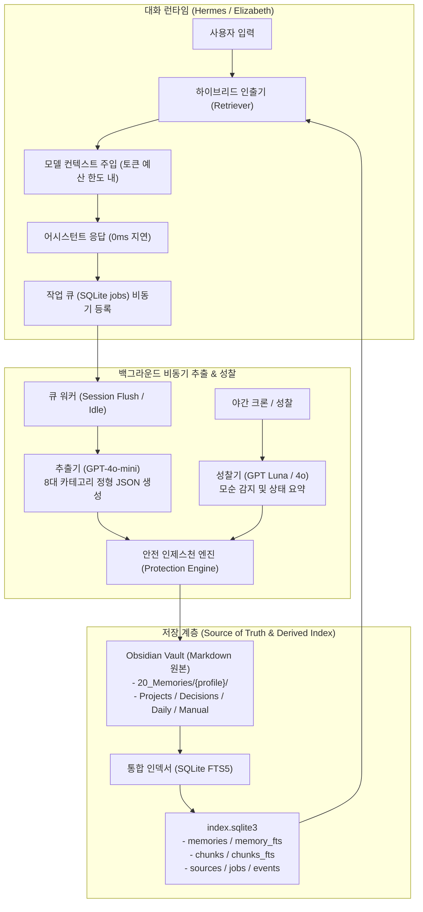

# Hermes Hybrid Obsidian Memory System (v2.0)

[-brightgreen.svg)]()
[]()
[]()

> **Hermes Agent를 위한 차세대 로컬 퍼스트 하이브리드 장기기억 시스템**  
> 대화가 바뀌어도 사용자의 맥락을 이어가고, 사용자 수동 편집을 100% 보존하며, 고성능 SQLite FTS5 검색과 비동기 큐를 통해 지연 시간 없이 최적의 기억을 인출합니다.

---

## 🌟 핵심 특징 (Key Features)

### 1. 단일 볼트 & 다중 프로필 격리 (Profile-Scoped Vault)
* 하나의 Obsidian Vault 내에서 각 프로필(`elizabeth`, `default` 등)의 기억을 독립 분리(`20_Memories/{profile}/`).
* 공통 지식 및 상식 풀(`shared`, `global`)을 함께 연계하여 유연한 맥락 공유 지원.

### 2. 3중 사용자 편집 보호 정책 (Zero-Loss Guarantee)
* **불변 잠금**: Frontmatter에 `user_locked: true` 또는 `source: manual`이 명시된 문서는 AI가 절대 수정하거나 덮어쓰지 않습니다 (Read-Only).
* **사용자 섹션 보존**: 노트 내 `## 사용자 수동 메모` 섹션은 어떤 재색인/동기화에도 영구 유지됩니다.
* **불변 추적(Supersede)**: 기억 정정 시 기존 노트를 덮어쓰지 않고 새 노트를 생성한 뒤 `superseded_by: [[새메모]]` 메타데이터로 연결하여 역사와 맥락을 온전히 보존합니다.

### 3. 8대 기억 분류 체계 (Core Categories)
대화에서 추출되는 기억을 8가지 유형으로 정밀하게 분류합니다:
1. `constraint` ⭐: 금기 사항, 절대 규칙, Don'ts (최우선 순위 주입)
2. `preference`: 사용자의 소통 및 코딩 스타일 선호
3. `decision`: 아키텍처 및 프로젝트 방향성 결정
4. `fact`: 환경 정보, 프로젝트 사실
5. `insight` ⭐: 트러블슈팅 노하우 및 실전 경험 지식
6. `plan`: 앞으로의 마일스톤 및 계획
7. `status` ⭐: 현재 작업 중단점 및 진행 맥락 (세션 재개용)
8. `entity`: 주요 도구, 인물, 프로젝트 개체

### 4. 0-레이턴시 비동기 큐 & 지능형 추출 파이프라인
* **대화 응답 지연 없음 (0ms)**: 대화 턴이 끝나는 즉시 백그라운드 SQLite `jobs` 테이블에 작업을 등록하고 사용자에게 즉각 응답합니다.
* **GPT-4o-mini 추출**: 세션 유휴 시간 또는 종료 시 정형화된 JSON 포맷으로 기억을 추출합니다. (오프라인 시 자체 룰 기반 엔진으로 자동 fallback)
* **보안 필터**: 저장 전 API 키, 비밀번호, 프롬프트 인젝션 패턴을 사전에 감지하고 차단합니다.

### 5. 하이브리드 인출 & 엄격한 토큰 예산 관리
* 매 턴 대화 시작 전, 볼트 크기에 관계없이 정해진 토큰 예산(기본 1,200 토큰) 내에서 **[핵심 제약/선호] + [관련 원자 기억 Top K] + [관련 지식 문서 청크]**를 황금 비율로 결합하여 프롬프트에 주입합니다.

---

## 📐 시스템 아키텍처



---

## 🚀 빠른 시작 및 CLI 사용법

### 1. 시스템 상태 확인
```bash
PYTHONPATH=. uv run --with pyyaml python3 -m src.cli --config 04_configuration/rebuild-memory.config.yaml status
```

### 2. 전체 볼트 재색인 (Markdown → SQLite FTS5)
```bash
PYTHONPATH=. uv run --with pyyaml python3 -m src.cli --config 04_configuration/rebuild-memory.config.yaml reindex
```

### 3. 하이브리드 검색 및 주입 패킷 테스트
```bash
PYTHONPATH=. uv run --with pyyaml python3 -m src.cli --config 04_configuration/rebuild-memory.config.yaml search "DB 설계 규칙" --max-tokens 1000
```

### 4. 사용자가 직접 불변 규칙 추가
```bash
PYTHONPATH=. uv run --with pyyaml python3 -m src.cli --config 04_configuration/rebuild-memory.config.yaml remember "테스트 통과 전에는 git commit 금지" --kind constraint --lock
```

### 5. 대기 중인 비동기 추출 큐 일괄 처리
```bash
PYTHONPATH=. uv run --with pyyaml python3 -m src.cli --config 04_configuration/rebuild-memory.config.yaml process-jobs
```

---

## 🧪 테스트 및 검증 결과

격리된 임시 볼트 환경에서 5개 핵심 시나리오 테스트를 100% 통과했습니다.

```bash
$ PYTHONPATH=. uv run --with pytest --with pyyaml pytest -v tests/test_rebuild_system.py

tests/test_rebuild_system.py::test_user_protection PASSED                [ 20%]
tests/test_rebuild_system.py::test_immutable_supersede_lifecycle PASSED  [ 40%]
tests/test_rebuild_system.py::test_hybrid_indexing_and_retrieval PASSED  [ 60%]
tests/test_rebuild_system.py::test_zero_latency_queue_extraction PASSED  [ 80%]
tests/test_rebuild_system.py::test_secret_filtering PASSED               [100%]
============================== 5 passed in 0.37s ===============================
```

---

## 📂 디렉터리 구조

```text
├── src/
│   ├── config.py         # 프로필, 볼트 경로, 모델 설정 스키마
│   ├── protection.py     # 3중 사용자 편집 보호 및 Frontmatter 파서
│   ├── db.py             # SQLite FTS5 스키마 및 비동기 작업 큐
│   ├── store.py          # 원자적 Markdown 파일 쓰기 및 Supersede 수명주기
│   ├── indexer.py        # 원자 기억 및 일반 지식 문서 헤딩 청킹 인덱서
│   ├── retriever.py      # 토큰 예산 기반 하이브리드 컨텍스트 인출기
│   ├── extractor.py      # 0ms 턴 캡처 및 GPT-4o-mini 비동기 큐레이터
│   ├── cli.py            # 독립 실행형 터미널 관리 도구
│   └── provider.py       # Hermes Agent 플러그인 어댑터
├── tests/
│   └── test_rebuild_system.py  # 격리 환경 검증 테스트 슈트
├── 04_configuration/
│   └── rebuild-memory.config.yaml # 기본 설정 템플릿
├── REBUILD_SUMMARY.md    # 개발 요약 보고서
└── README.md             # 프로젝트 메인 안내서
```
