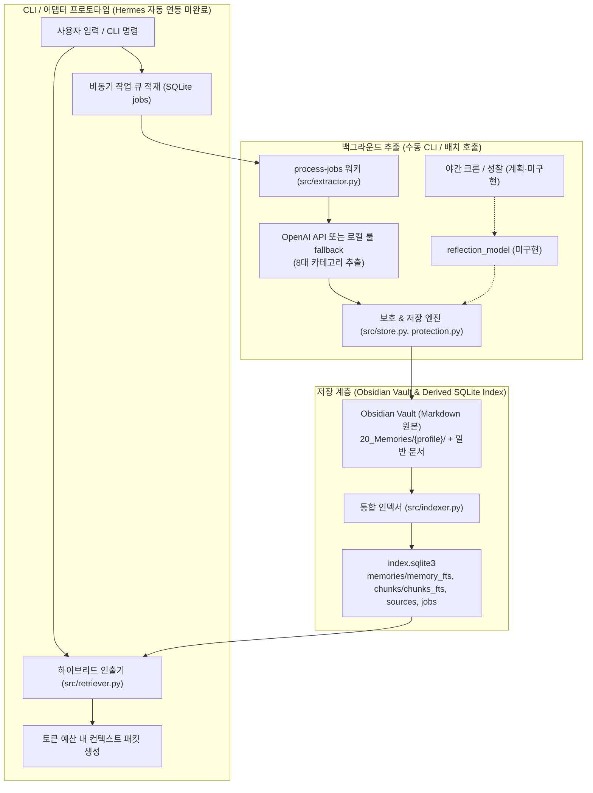

# Hermes Hybrid Obsidian Memory System (v2.0 Prototype)

[-brightgreen.svg)]()
[]()
[]()
[]()

> **Obsidian Markdown과 SQLite FTS5 기반의 로컬 퍼스트 하이브리드 장기기억 엔진 프로토타입**  
> 기존에 분리되어 있던 **문서 청크 인덱서(시스템 B)**와 **원자 기억 저장소(시스템 C)**의 핵심 저장·색인·인출 로직을 `src/` 패키지와 독립 실행형 CLI로 통합했습니다.  
> 실제 Hermes Agent 런타임 자동 연동(`src/provider.py`) 및 야간 성찰 크론(`reflection_model`)은 아직 프로토타입/설계 단계입니다.

---

## 📌 구현 현황 및 검증 범위 (Implemented vs. Planned)

포트폴리오 및 코드 검토 시 오해가 없도록 **실제 동작하는 기능**과 **미완료/프로토타입 영역**을 구분합니다.

| 구분 | 항목 | 현재 상태 | 비고 |
|---|---|---|---|
| **구현 완료 (`src/` + CLI)** | 프로필 기반 볼트 구조 & 설정 오버라이드 (`src/config.py`) | ✅ 동작 | `20_Memories/{profile}/` + `shared`, `global` 및 `--vault`/`--profile`/환경변수 지원 |
| **구현 완료 (`src/` + CLI)** | 3중 사용자 편집 보호 (`src/protection.py`, `src/store.py`) | ✅ 동작 | `user_locked: true`/`source: manual` 수정 차단, 지정 사용자 섹션(`## 사용자 수동 메모` 등) 승계, `superseded` 비파괴 정정 |
| **구현 완료 (`src/` + CLI)** | SQLite FTS5 + 비동기 `jobs` 큐 (`src/db.py`, `src/indexer.py`) | ✅ 동작 | 원자 기억 + 일반 Markdown 문서 헤딩 청킹 인덱싱 |
| **구현 완료 (`src/` + CLI)** | 하이브리드 인출기 (`src/retriever.py`) | ✅ 동작 | 토큰 예산 배분 + FTS5 접두사·한국어 조사 완화·`LIKE` 부분 일치 fallback |
| **구현 완료 (`src/` + CLI)** | 턴 캡처 큐잉 & 추출기 (`src/extractor.py`) | ✅ 동작 | 비밀키/인젝션 차단 후 `jobs` 적재, OpenAI 호환 API 또는 오프라인 규칙 기반 fallback |
| **구현 완료 (`src/` + CLI)** | 독립 관리 CLI (`src/cli.py`) | ✅ 동작 | `status`, `remember`, `capture`, `process-jobs`, `reindex`, `search`, `correct` |
| **프로토타입 / 미완료** | Hermes Agent 자동 연동 (`src/provider.py`) | 🚧 초안 | `RebuiltObsidianMemoryProvider` 어댑터 클래스만 존재하며 `MemoryProvider` ABC, `plugin.yaml`, `register()`, `sync_turn()` 런타임 연동은 미완료 (기존 v0.1 참고본은 `01_current_provider/obsidian/`) |
| **미구현 (계획)** | 야간 성찰 / 모순 감지 워커 (`reflection_model`) | ⏳ 미구현 | 설정 스키마에 필드만 정의되어 있으며 실행 코드는 없음 |
| **미구현 (계획)** | 벡터/시맨틱 및 그래프 검색 | ⏳ 미구현 | 현재 키워드·조사 완화·부분 문자열 검색만 지원 |

* **검증 환경**: macOS 로컬 환경(Python 3.9.6 및 Python 3.11.15)의 격리된 임시 볼트에서 단위/통합 테스트 8종과 CLI 수동 시나리오를 검증했습니다. Windows/Linux 환경이나 실제 운영 Obsidian Vault + Hermes 데몬 자동 연동은 검증하지 않았습니다.

---

## 🌟 주요 설계 및 동작 방식

### 1. 단일 볼트 & 다중 프로필 분리 (`src/config.py`)
* 하나의 Obsidian Vault 내에서 프로필(`default`, `personal`, `work` 등)별로 기억을 `20_Memories/{profile}/`에 저장합니다.
* 필요 시 `shared`, `global` 폴더의 공통 기억을 함께 조회하도록 설정(`include_shared: true`)할 수 있습니다. *(폴더 분리 방식이며 OS 레벨 접근 제어를 제공하지는 않습니다.)*

### 2. 3중 사용자 편집 보호 메커니즘 (`src/protection.py`, `src/store.py`)
* **불변 잠금**: Frontmatter에 `user_locked: true` 또는 `source: manual`이 명시된 노트는 `store.correct()` 호출 시 `PermissionError`를 발생시켜 수정을 차단합니다.
* **사용자 수동 섹션 승계**: 정정(`correct`)으로 새 노트를 생성할 때 `## 사용자 수동 메모`, `## User Notes`, `## Manual Notes` 헤더로 시작하는 섹션을 추출해 새 노트에 이어 붙입니다. *(잠금되지 않은 노트의 임의 본문 편집을 자동 병합하는 기능은 아니므로, 보존이 필요한 메모는 `user_locked: true` 또는 해당 섹션 사용을 권장합니다.)*
* **비파괴 정정(Supersede)**: 기존 노트를 삭제/덮어쓰기하지 않고 `status: superseded` 및 `superseded_by: [[새메모ID]]`를 기록한 뒤 새 기억을 생성합니다.

### 3. 8대 기억 분류 체계 (Core Categories)
`constraint`, `preference`, `decision`, `fact`, `insight`, `plan`, `status`, `entity` 8가지 유형으로 기억을 저장하고 인출 시 우선순위를 반영합니다.

### 4. 응답 경로 분리 비동기 큐 & 추출 파이프라인 (`src/extractor.py`)
* **비동기 큐 적재**: `capture_turn()`은 턴 원문과 추출 작업을 로컬 SQLite `sources`/`jobs` 테이블에 먼저 등록해, 대화 턴 중 외부 LLM API 응답을 기다리지 않도록 분리합니다. *(로컬 SQLite 쓰기 비용은 발생하며, 물리적 0ms가 아닙니다.)*
* **백그라운드 추출**: `process-jobs` 실행 시 `OPENAI_API_KEY` 환경변수(또는 `api_key_env`)가 설정되어 있으면 `extractor_model`(기본 `gpt-4o-mini`)을 호출하고, 키가 없거나 오프라인이면 결정적 규칙 기반 fallback 추출기로 동작합니다.
* **사전 보안 필터**: API 키, Bearer 토큰, 프롬프트 인젝션 패턴이 감지된 턴은 큐 적재를 건너뜁니다.

### 5. 토큰 예산 기반 하이브리드 인출 & 검색 범위 (`src/retriever.py`)
* 기본 토큰 예산(1,200 tokens) 내에서 **[핵심 제약/선호]** → **[관련 원자 기억]** → **[관련 일반 Markdown 문서 청크]** 순으로 컨텍스트 패킷을 조립합니다.
* **검색 방식 및 한계**:
  * SQLite FTS5(`unicode61` 토크나이저)의 정확/접두사 매칭(`"token"*`)과 기본 한국어 조사 제거(예: `"SQLite를"` ↔ `"SQLite"`), 그리고 FTS5 결과가 부족할 때의 SQL `LIKE` 부분 문자열 fallback(예: `"비동기큐설계"`에서 `"큐"`·`"설계"` 검색)을 조합해 동작합니다.
  * 형태소 분석기(Kiwi/Mecab 등)나 벡터 임베딩은 포함하지 않으므로, 동의어 검색·문맥 추론·복잡한 동사/형용사 활용 검색은 지원하지 않습니다.

---

## 📐 시스템 아키텍처



---

## ⚙️ 설치 및 환경 요구사항

* **Python**: `3.9` 이상 (표준 라이브러리 `sqlite3` FTS5 지원 필요; Python `3.9.6` 및 `3.11.15`에서 검증)
* **필수 패키지**: `PyYAML >= 6.0` ([`requirements.txt`](requirements.txt), [`pyproject.toml`](pyproject.toml))
* **테스트 패키지(선택)**: `pytest >= 7.0`

### 방법 A: `venv` + `pip` 사용
```bash
git clone https://github.com/obsidia-w/hermes-hybrid-memory.git
cd hermes-hybrid-memory

python3 -m venv .venv
source .venv/bin/activate          # Windows PowerShell: .venv\Scripts\Activate.ps1
pip install -r requirements.txt
# 테스트까지 실행하려면:
pip install -e ".[dev]"
```

### 방법 B: `uv` 사용 (설치 없이 바로 실행)
```bash
git clone https://github.com/obsidia-w/hermes-hybrid-memory.git
cd hermes-hybrid-memory
```

---

## 🔧 설정 변경 방법 (Vault 경로 & 프로필)

[`04_configuration/rebuild-memory.config.yaml`](04_configuration/rebuild-memory.config.yaml)은 **예제 기본 설정 파일**입니다. 기본값은 저장소 루트 기준 임시 데모 경로(`./demo_vault`)와 `default` 프로필로 설정되어 있으며, 본인 환경에 맞게 아래 3가지 방법 중 하나로 변경할 수 있습니다.

1. **설정 파일 직접 수정 또는 복사본 사용**
   ```yaml
   # my-memory.config.yaml
   schema_version: 2
   vault_path: /path/to/your/Obsidian-Vault   # Windows 예: C:/Users/name/Documents/ObsidianVault
   profile: personal                          # 예: default, personal, work
   ```
2. **환경변수 오버라이드** (설정 파일보다 우선 적용)
   ```bash
   export HERMES_MEMORY_VAULT="/path/to/your/Obsidian-Vault"
   export HERMES_MEMORY_PROFILE="personal"
   ```
3. **CLI 플래그 오버라이드** (최우선 적용)
   ```bash
   PYTHONPATH=. python3 -m src.cli --vault /tmp/my-test-vault --profile demo status
   ```

> **참고**: `01_current_provider/` ~ `08_database_schemas/` 폴더는 재설계 전 기존 시스템의 **참조 스냅샷**입니다. [`MANIFEST.json`](MANIFEST.json)의 SHA-256 무결성 검증을 위해 원본 환경 경로(`/home/hermes/...`, 프로필 `elizabeth`)가 그대로 보존되어 있으며, 새 `src/` 엔진은 이 경로들에 의존하지 않습니다.

---

## 🚀 처음부터 따라 해보는 재현 가이드 (임시 폴더 기준)

원본 Vault를 건드리지 않고 격리된 임시 폴더(`/tmp/hermes-memory-demo`)에서 저장 → 색인 → 검색(한글 조사·부분 일치) → 정정 → 비동기 큐 처리를 그대로 재현할 수 있습니다. (`pip install -r requirements.txt` 완료 후 또는 `uv run --with pyyaml` 사용)

```bash
# 1. 임시 데모 Vault 준비 및 상태 확인
DEMO_VAULT=/tmp/hermes-memory-demo
rm -rf "$DEMO_VAULT"
mkdir -p "$DEMO_VAULT/Projects"

PYTHONPATH=. uv run --with pyyaml python3 -m src.cli \
  --config 04_configuration/rebuild-memory.config.yaml \
  --vault "$DEMO_VAULT" --profile demo status

# 2. 기억 저장 (잠금 규칙 1개 + 일반 결정 1개 + 복합어 인사이트 1개)
PYTHONPATH=. uv run --with pyyaml python3 -m src.cli \
  --vault "$DEMO_VAULT" --profile demo \
  remember "테스트 통과 전에는 git commit 하지 않는다." --kind constraint --lock

PYTHONPATH=. uv run --with pyyaml python3 -m src.cli \
  --vault "$DEMO_VAULT" --profile demo \
  remember "로컬 저장소로 SQLite를 사용한다." --kind decision

PYTHONPATH=. uv run --with pyyaml python3 -m src.cli \
  --vault "$DEMO_VAULT" --profile demo \
  remember "비동기큐설계에 따라 턴 기록과 추출을 분리한다." --kind insight

# 3. 일반 Markdown 문서 추가 후 전체 볼트 재색인
cat <<'EOF' > "$DEMO_VAULT/Projects/Architecture.md"
# 메모리 아키텍처 노트
## 데이터베이스설계
이 프로젝트는 SQLite FTS5와 헤딩 청킹 인덱서를 사용합니다.
EOF

PYTHONPATH=. uv run --with pyyaml python3 -m src.cli \
  --vault "$DEMO_VAULT" --profile demo reindex

# 4. 하이브리드 검색 재현 (조사 포함 & 복합어 부분 일치 포함)
PYTHONPATH=. uv run --with pyyaml python3 -m src.cli \
  --vault "$DEMO_VAULT" --profile demo search "SQLite"

PYTHONPATH=. uv run --with pyyaml python3 -m src.cli \
  --vault "$DEMO_VAULT" --profile demo search "설계"

# 5. 비동기 턴 캡처 -> 백그라운드 큐 추출 처리 -> 검색 확인
PYTHONPATH=. uv run --with pyyaml python3 -m src.cli \
  --vault "$DEMO_VAULT" --profile demo \
  capture --user "앞으로는 Python으로 작성하고 간결한 스타일로 해줘." --assistant "알겠습니다."

PYTHONPATH=. uv run --with pyyaml python3 -m src.cli \
  --vault "$DEMO_VAULT" --profile demo process-jobs

PYTHONPATH=. uv run --with pyyaml python3 -m src.cli \
  --vault "$DEMO_VAULT" --profile demo search "Python"
```

기억을 정정(Supersede)하려면 기억 파일의 `mem-...` ID를 지정합니다:
```bash
PYTHONPATH=. uv run --with pyyaml python3 -m src.cli \
  --vault "$DEMO_VAULT" --profile demo \
  correct mem-xxxxxxxxxx "로컬 저장소는 SQLite FTS5로 최종 확정한다." --reason "FTS5 확정"
```

---

## 🧪 테스트 실행

격리된 임시 디렉터리(`tempfile.TemporaryDirectory` / `tmp_path`)에서 8개 단위·통합 테스트가 실행됩니다.

```bash
# uv 사용 시
PYTHONPATH=. uv run --with pytest --with pyyaml pytest -v tests/test_rebuild_system.py

# venv에서 pip install -e ".[dev]" 후 실행 시
pytest -v tests/test_rebuild_system.py
```

포함된 테스트 케이스:
1. `test_user_protection`: `user_locked: true` 노트 정정 시 `PermissionError` 차단 확인
2. `test_immutable_supersede_lifecycle`: 정정 시 기존 노트 비파괴 `superseded` 처리 및 새 노트 연결 확인
3. `test_hybrid_indexing_and_retrieval`: 제약 우선 주입 + 원자 기억 + 문서 청크 하이브리드 인출 확인
4. `test_zero_latency_queue_extraction`: 턴 캡처 → `jobs` 큐 등록 → 오프라인 fallback 추출 완료 확인
5. `test_secret_filtering`: API 키 포함 턴의 큐 등록 사전 차단 확인
6. `test_korean_particle_and_partial_match_retrieval`: 한글 조사(`SQLite를` ↔ `SQLite`, `Python으로` ↔ `Python`) 및 복합어 부분 일치(`비동기큐설계`, `데이터베이스설계`) 검색 확인
7. `test_user_manual_section_preserved_on_correct`: 정정 시 `## 사용자 수동 메모` 섹션 승계 확인
8. `test_config_override_and_cli_roundtrip`: 환경변수 오버라이드, 잘못된 `--config` 경로 오류 처리, CLI 전체 흐름 확인

---

## 📂 디렉터리 구조

```text
├── src/                                  # 새 하이브리드 메모리 엔진 (CLI 동작)
│   ├── config.py                         # 설정 스키마 및 경로/프로필 오버라이드 로더
│   ├── protection.py                     # 3중 사용자 편집 보호 및 Frontmatter 파서
│   ├── db.py                             # SQLite FTS5 스키마 및 비동기 jobs 큐
│   ├── store.py                          # 원자적 Markdown 쓰기 및 Supersede 수명주기
│   ├── indexer.py                        # 원자 기억 및 일반 문서 헤딩 청킹 인덱서
│   ├── retriever.py                      # 토큰 예산 기반 하이브리드 인출기 (조사 완화 + 부분 일치)
│   ├── extractor.py                      # 턴 캡처 큐잉 및 OpenAI/로컬 fallback 추출기
│   ├── cli.py                            # 독립 실행형 CLI (status/remember/capture/process-jobs/reindex/search/correct)
│   └── provider.py                       # Hermes Agent용 어댑터 프로토타입 (미연동 초안)
├── tests/
│   └── test_rebuild_system.py            # 격리 환경 단위/통합 테스트 (8개)
├── 04_configuration/
│   ├── rebuild-memory.config.yaml        # v2.0 CLI 예제 설정 템플릿 (./demo_vault, default)
│   ├── obsidian-memory.config.yaml       # [스냅샷] v0.1 운영 설정 참고본
│   ├── core_memory.selected.yaml         # [스냅샷] Hermes 코어 메모리 설정 발췌본
│   └── vault-path.env.example            # [스냅샷] 기존 경로 환경변수 예시
├── 01_current_provider/ ~ 08_database_schemas/
│                                         # 재설계 전 원본 시스템 참고 스냅샷 (MANIFEST.json 추적 대상)
├── pyproject.toml                        # Python 버전(>=3.9) 및 패키지 메타데이터
├── requirements.txt                      # 최소 실행 의존성 (PyYAML)
├── REBUILD_BRIEF.md                      # 재설계 목표 및 주의사항
├── REBUILD_SUMMARY.md                    # 구현 범위 및 검증 요약 보고서
└── README.md                             # 프로젝트 메인 안내서
```
